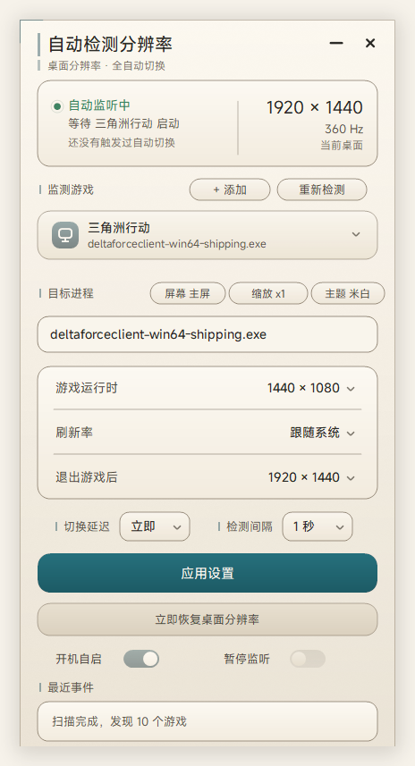

# ResPilot · 分辨率自动巡航

Windows 10/11 游戏分辨率自动切换工具，面向原生 4K、2K 及以上屏幕、想在全屏无边框下用 1K 拉满帧率的玩家；对习惯 4:3 的 FPS 玩家也很友好。

进游戏自动切到设定的游戏分辨率、画面比例与刷新率：原生 4K/2K 屏，想在全屏无边框下用 1920×1080（1K）拉满帧率；习惯 4:3 拉伸的玩家，也能直接选 4:3 比例。退出后默认恢复屏幕最高分辨率，刷新率、缩放和布局也一并还原。游戏分辨率、画面比例、刷新率、恢复方式、主题都可自定义。

**[打开 ResPilot 官网 →](https://van1sh-ldu.github.io/ResPilot/)** — 功能说明、真实界面截图与下载入口。



**官网**：[van1sh-ldu.github.io/ResPilot](https://van1sh-ldu.github.io/ResPilot/) · **下载**：[最新 Release](../../releases/latest) · **反馈**：[GitHub Issues](../../issues) · **License**：[MIT](LICENSE.txt)

## 适合谁

- 原生 4K、2K 及以上显示器，想在全屏无边框下用 1K 分辨率把帧率拉满
- 习惯 4:3 拉伸的 FPS 玩家
- 希望游戏分辨率和退出恢复分辨率能分别选比例的人
- 希望退出游戏默认回到屏幕最高分辨率，不想手动改的人
- 多个游戏需要不同分辨率/刷新率，不想每次手动来回改的人

## 它解决什么问题

原生 4K、2K 屏幕在桌面很细腻，但游戏里全屏无边框跑原生分辨率，帧率往往上不去。很多 FPS 玩家会把游戏切到 1920×1080（1K）来拉高帧率，也有人习惯 4:3 拉伸；麻烦的是，退出游戏后桌面如果还停在低分辨率，图标、窗口、缩放全乱。

这个工具只做一件事：游戏启动时切到你设定的游戏分辨率与刷新率，游戏退出时默认恢复屏幕最高分辨率，刷新率、缩放和布局也一并还原；恢复方式也可以自己改。

- 不进游戏内核、不读游戏内存、不修改游戏文件
- 只调用 Windows 显示设置接口，使用显卡驱动真实支持的分辨率与刷新率
- 退出游戏后默认恢复屏幕最高分辨率，失败会重试；恢复方式可自定义
- 托盘常驻、单实例、开机自启可选

## 下载

到 [Releases](../../releases/latest) 下载：

| 文件 | 用途 |
| --- | --- |
| `ResPilot_v1.4.0_setup.exe` | 安装版，双击安装，默认装到 `%LOCALAPPDATA%\Programs\ResPilot`，不需要管理员权限 |
| `ResPilot_v1.4.0_portable.exe` | 便携版，免安装，直接运行 |
| `SHA256SUMS.txt` | 发布包 SHA256，下载后可核对 |

> 当前 Release 使用 ASCII 文件名；安装包未做代码签名，首次运行可能触发 Windows SmartScreen。介意的话可以先用源码自行构建，或核对 SHA256 后再运行。

## 快速开始

1. 打开程序，在“游戏运行时”选**画面比例**和**分辨率**。想拉高帧率可选 16:9 + `1920 × 1080`（1K）；习惯 4:3 可选 4:3 + `1440 × 1080`。比例列表来自当前显示器实际支持的模式。
2. “刷新率”选“跟随系统”或该分辨率下驱动支持的 Hz。
3. “退出游戏后”也能单独选比例和分辨率；默认恢复屏幕最高分辨率（4K/2K 屏就是原生分辨率）。想固定到某个模式，也可以在菜单里自己选。
4. 点“应用设置”，之后启动游戏即可。

目标进程默认是《三角洲行动》，也可以在“监测游戏”里添加别的游戏。

## 功能

| 功能 | 说明 |
| --- | --- |
| 游戏检测 | 进程名精确匹配 + 主体名兜底（剥离 `-win64-shipping` 等后缀），启动/退出二次确认 |
| 分辨率切换 | 调用 `ChangeDisplaySettingsEx`，只使用驱动真实支持的模式 |
| 画面比例 | 游戏运行时、退出游戏后可分别选择 16:9 / 16:10 / 4:3 等比例，自动匹配当前显示器支持的分辨率 |
| 刷新率 | 可选“跟随系统”或该分辨率下驱动支持的任意 Hz；切换判断同时比较分辨率与刷新率 |
| 恢复 | 默认恢复屏幕最高分辨率，也可固定指定模式；失败自动重试；异常退出下次启动会恢复 |
| 自定义 | 游戏分辨率、画面比例、刷新率、恢复方式、监测游戏、检测间隔、切换延迟、主题、开机自启均可调整 |
| 配置备份 | 每次内容变化先备份，保留 `.bak` 与 `backup\settings-*.ini` 最近 10 份 |
| 崩溃日志 | 未处理异常写入 `crash.log` 并弹窗提示路径 |
| 主题 | 珠链 / 深空 / 米白三套界面主题，主界面右上角切换 |

## 可自定义

默认值只是起点，常用项都能改：

- 游戏分辨率：任意驱动支持的模式，常用 `1920 × 1080`（1K）或 `1440 × 1080`（4:3）
- 画面比例：游戏运行时和退出游戏后可分别选 16:9 / 16:10 / 4:3 等，选完自动匹配该比例下合适的分辨率
- 刷新率：跟随系统，或指定该分辨率下驱动支持的 Hz
- 退出恢复：默认屏幕最高分辨率，也可固定到某个模式
- 主题：珠链 / 深空 / 米白
- 监测游戏：内置《三角洲行动》，也可以手动添加 exe
- 检测间隔、切换延迟、开机自启

## 兼容性与边界

- Windows 10/11 x64；程序是单文件 WinForms，使用系统自带 .NET Framework 4.x，不需要额外安装运行时。
- 分辨率与刷新率来自系统枚举，驱动不支持的组合不会出现在列表里。
- 主要面向全屏无边框；独占全屏、HDR、多显示器、不同 DPI、远程桌面等场景可能有差异，建议先在无关紧要的窗口里试一次。
- 本项目是非官方工具，与游戏开发商、发行商无关联；游戏名称只用于说明兼容性。

## 配置与备份

配置目录 `%LOCALAPPDATA%\ResPilot`：

```text
settings.ini          当前配置
settings.ini.bak      上一版
backup\               历史备份（settings-时间.ini / install-时间.ini）
auto.log              运行日志
crash.log             崩溃日志（发生才生成）
fonts\                内嵌字体解压缓存
```

读取顺序：`settings.ini` → `.bak` → `backup\` 最新一份 → 内置默认值。写入时只有内容变化才备份，最多保留 10 份。

配置项示例见 [`settings.example.ini`](settings.example.ini)。

## 安装包与完整性

安装器是自绘的单文件 EXE，内嵌程序、卸载器和 SHA256 清单：

- 默认安装到 `%LOCALAPPDATA%\Programs\ResPilot`，普通权限
- 可选桌面快捷方式、开机自启、安装后立即运行
- 安装前备份已有配置到 `backup\install-时间.ini`
- 释放前后各做一次 SHA256 校验，不一致会中止
- 写入 HKCU 卸载项，可在“设置 → 应用”卸载；卸载默认保留配置

静默参数：

```text
ResPilot_v1.4.0_setup.exe /S /D=C:\Path /NOSHORTCUT /NOAUTOSTART /NORUN
uninstall.exe /S [/DELCONFIG]
```

安装目录内 `manifest.sha256` 每行 `hash *文件名`，可这样复核：

```powershell
Get-Content manifest.sha256 | ForEach-Object {
  $h,$f = $_ -split ' \*',2
  if ((Get-FileHash $f -Algorithm SHA256).Hash.ToLower() -ne $h) { "损坏: $f" }
}
```

## 从源码构建

需要 Windows + .NET Framework 4.x（系统自带 `csc.exe` 即可），不需要 Visual Studio。

```powershell
git clone https://github.com/Van1sh-LDu/ResPilot.git
cd ResPilot
powershell -ExecutionPolicy Bypass -File .\tools\build.ps1
```

产物在 `dist\`：主程序、卸载器、安装器和 `SHA256SUMS.txt`。构建脚本会编译主程序（内嵌图标/字体/背景）→ 编译卸载器 → 生成清单 → 编译安装器（内嵌全部 payload）→ 计算安装包哈希。

## 项目结构

```text
src\ResPilot.cs      主程序
src\Installer.cs         安装器
src\Uninstaller.cs       卸载器
src\VersionInfo.cs       程序集版本信息
res\                     图标、清单、MiSans 字体子集、背景图
tools\build.ps1          一键构建
docs\                    界面截图与发布说明
README-installed.txt     安装包内说明
settings.example.ini     配置示例
```

## 第三方资源

主程序内嵌了 MiSans 字体子集，仓库 `res\` 下还有图标和背景图。MIT 许可证只覆盖本项目代码，不覆盖这些第三方资源；使用与再分发前请阅读 [`THIRD_PARTY_NOTICES.md`](THIRD_PARTY_NOTICES.md)。

## 参与

- 遇到问题先开 [Issue](../../issues)，附 Windows 版本、显卡/显示器、游戏名和复现步骤。
- 软件右下角和托盘菜单也提供 GitHub Issues 入口。
- 接受 PR，但涉及分辨率切换的改动需要说明测试环境。
- 作者：冷渡-Van1sh

## License

[MIT](LICENSE.txt) © 2026 冷渡-Van1sh
